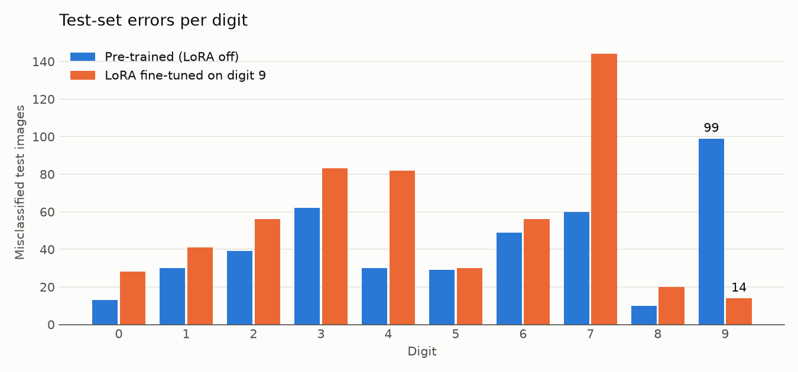

# pytorch-lora

A from-scratch implementation of **LoRA: Low-Rank Adaptation of Large Language Models**
([Hu et al., 2021](https://arxiv.org/abs/2106.09685)) in PyTorch, using
[`torch.nn.utils.parametrize`](https://pytorch.org/tutorials/intermediate/parametrizations.html).

An intentionally oversized MLP is pre-trained on MNIST, then a rank-1 LoRA adapter (**0.24%** extra
parameters) fine-tunes it on the digit it struggles with most. The original weights are never modified.



## How it works

For each linear layer the frozen weight $W \in \mathbb{R}^{d_{out} \times d_{in}}$ is re-parametrized as

$$W' = W + \frac{\alpha}{r} B A, \qquad B \in \mathbb{R}^{d_{out} \times r},\ A \in \mathbb{R}^{r \times d_{in}}$$

with $A$ initialized from a Gaussian and $B$ at zero, so the adapter starts as a no-op. Only $A$ and
$B$ are trained. The core is a small module:

```python
class LoRAParametrization(nn.Module):
    def __init__(self, features_in, features_out, rank=1, alpha=1, device="cpu"):
        super().__init__()
        self.lora_A = nn.Parameter(torch.zeros((rank, features_in), device=device))
        self.lora_B = nn.Parameter(torch.zeros((features_out, rank), device=device))
        nn.init.normal_(self.lora_A, mean=0, std=1)
        self.scale = alpha / rank
        self.enabled = True

    def forward(self, original_weights):
        if self.enabled:
            return original_weights + (self.lora_B @ self.lora_A) * self.scale
        return original_weights
```

## Results

From the committed notebook run (CPU, seed 0, PyTorch 2.15):

| | Accuracy | Errors on digit 9 | Trainable params |
|---|---:|---:|---:|
| Pre-trained network | 0.958 | 99 | 2,807,010 |
| + LoRA (r = 1), 100 batches of 9s | 0.945 | 14 | 6,794 |
| LoRA disabled again | 0.958 | 99 | — |
| LoRA merged into the weights | 0.945 | 14 | — |

The notebook checks all of the following with asserts:

- the frozen weights and biases are bit-for-bit unchanged after fine-tuning;
- with LoRA enabled, `layer.weight == W + (B @ A) * scale`;
- disabling the adapter gives back exactly the pre-trained results;
- the merged network has the original parameter count and produces the same outputs.

Fine-tuning on a single digit also shows LoRA's limit: errors on other digits go up. LoRA constrains
*how* the weights can change, not *what* they are optimized for.

## Running it

```bash
python -m venv .venv
source .venv/bin/activate
pip install -r requirements.txt
jupyter notebook lora.ipynb
```

MNIST (~60 MB) is downloaded to `./data` on the first run. The whole notebook takes about 3 minutes
on a laptop CPU and runs faster on a GPU, which is picked up automatically. Exact numbers vary between
hardware and PyTorch versions.

## References

- Hu, E. J. et al. *LoRA: Low-Rank Adaptation of Large Language Models.* 2021. [arXiv:2106.09685](https://arxiv.org/abs/2106.09685)
